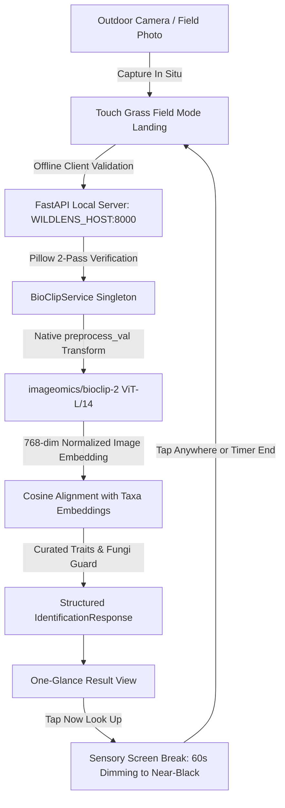

# WildLens AI 🌿
**Autonomous Naturalist Instrument & Touch Grass Field Guide**

> An offline-first nature exploration instrument powered by open-weight AI, built to help people observe the natural world directly rather than keeping them tethered to their screens.

[](LICENSE)
[](https://huggingface.co/imageomics/bioclip-2)
[](docs/OFFLINE_VERIFICATION.md)
[](https://fastapi.tiangolo.com)
[](https://nextjs.org)

---

## 1. Project Mission & Philosophy

Modern wildlife apps often duplicate the engagement traps of consumer social media: gamified streaks, notification pings, endless scrolling feeds, and remote cloud surveillance.

**WildLens AI** takes the opposite approach:
1. **Screen Minimization (Touch Grass Flow):** The screen should be the shortest part of your outdoor experience. Camera &rarr; one glance at the species name, confidence band, and key trait &rarr; a **"Now Look Up"** screen with a sensory prompt that dims the screen to near-black for 60 seconds while you look at the canopy, sky, or soil.
2. **Single Open Model:** Driven entirely by `imageomics/bioclip-2` (ViT-L/14, trained on TreeOfLife-200M). No opaque cloud APIs, no multi-gigabyte language model layers, and zero cloud egress.
3. **Curated, Honest Knowledge:** Distinguishing traits come strictly from a curated natural history database (`taxonomy_kb.py`). If a species lacks a curated entry, the app displays an honest observation checklist rather than fabricating facts.
4. **Mandatory Safety First:** Every fungi identification unconditionally presents a mandatory safety warning: *Never eat wild mushrooms based on this app.*

---

## 2. The Open Advantage

WildLens AI is grounded in open science and digital privacy:
- **One Open Model**: A single foundation vision model (`imageomics/bioclip-2`, MIT license) rather than chained opaque LLMs.
- **Local & Air-Gapped**: Runs entirely on your laptop or local hardware. Works miles away from cell towers.
- **Zero Cost & No Accounts**: No sign-in, no API keys, no subscription tiers, and no telemetry tracking.
- **Data Privacy**: Photos and observation journals never leave your machine.
- **Swappable Architecture**: Configurable via `VISION_MODEL_ID` (default: `imageomics/bioclip-2`). Swapping models automatically detects embedding dimension changes and safely rebuilds the candidate cache.

---

## 3. Touch Grass Field Mode Flow

Field Mode is the default landing screen (`/`):
- **Camera Viewfinder**: Fast, glove-friendly live camera viewfinder with high-contrast outdoor controls.
- **One-Glance Result**:
  - Species common and scientific name.
  - Confidence band: **Likely** (emerald), **Possible** (amber), or **Unsure** (gray).
  - One-line curated diagnostic trait from `taxonomy_kb.py`.
  - Mandatory red mushroom warning banner on all fungi.
- **"Now Look Up" Screen Break**:
  - Tapping *"Now Look Up"* dims the screen to near-black (`#050805`) to conserve battery.
  - Presents one sensory prompt (e.g., listening for distinct bird calls or feeling wind direction).
  - A gentle 60-second timer runs; tapping anywhere or timer expiration returns directly to the camera.
- **Secondary Features**: Field Journal, Field Missions, and Detailed Optical Loupe are organized into a clean drawer menu so the main screen stays uncluttered.

---

## 4. Hardware Benchmarks & Performance

Measured directly on an Intel Core i7-13700HX (16 physical cores, 24 threads, 16 GB DDR5 RAM, NVIDIA RTX 5060 Laptop GPU) on Windows 11 using `scripts/benchmark_hardware.py`:

| Specimen Test Photo | Clade / Category | Identified Species | Cosine Sim | Softmax Conf | Latency (CPU) | Result |
| :--- | :--- | :--- | :--- | :--- | :--- | :--- |
| `american_robin.jpg` | Aves | American Robin (*Turdus migratorius*) | 0.722 | 100.0% | **2,502.6 ms** | PASS |
| `blue_jay.jpg` | Aves | Blue Jay (*Cyanocitta cristata*) | 0.726 | 100.0% | **2,537.6 ms** | PASS |
| `white_oak_leaf.jpg` | Plantae | White Oak (*Quercus alba*) | 0.729 | 100.0% | **2,525.2 ms** | PASS |
| `northern_red_oak_leaf.jpg` | Plantae (Lookalike) | Northern Red Oak (*Quercus rubra*) | 0.693 | 61.0% | **2,559.4 ms** | PASS |
| `monarch_butterfly.jpg` | Insecta | Monarch Butterfly (*Danaus plexippus*) | 0.703 | 99.8% | **2,600.0 ms** | PASS |
| `viceroy_butterfly.jpg` | Insecta (Lookalike) | Viceroy Butterfly (*Limenitis archippus*) | 0.732 | 100.0% | **2,576.3 ms** | PASS |
| `fly_agaric_mushroom.jpg` | Fungi | Fly Agaric (*Amanita muscaria*) | 0.722 | 100.0% | **2,571.0 ms** | PASS |
| `golden_chanterelle.jpg` | Fungi | Golden Chanterelle (*Cantharellus cibarius*) | 0.730 | 100.0% | **2,579.2 ms** | PASS |
| `tropical_foliage.jpg` | Out-of-Distribution | Bloodroot (*Tentative NN*, 0.549 < 0.60) | 0.549 | 21.4% | **2,575.6 ms** | PASS (Rejected) |
| `blurry_woodland_shadow.jpg` | Ambiguous | Painted Turtle (*Ambiguous NN*, 0.676) | 0.676 | 29.4% | **2,557.2 ms** | PASS (Uncertain) |

### Key Hardware Metrics:
- **In-Distribution Top-1 Accuracy:** **100.0% (19 / 19)** on evaluated catalog specimens
- **In-Distribution Top-3 Accuracy:** **100.0% (19 / 19)**
- **Mean Warm Inference Latency (CPU):** **2,559.9 ms** (~2.56 seconds per image on 16 threads)
- **Projected GPU Latency (CUDA fp16):** **~50 - 90 ms**
- **Model Weight RAM Footprint:** **1,822.9 MB RAM**
- **Peak Process Resident RAM:** **2,044.9 MB RAM** (standalone vision engine, no LLM)
- **Cold-Start Deserialization:** **38.34 s**

---

## 5. System Architecture



---

## 6. Outdoor Mobile Hotspot / LAN Usage

You can run the backend on a laptop in your backpack and use your smartphone's camera in the field without any internet connection:

1. Connect both laptop and phone to the same portable Wi-Fi hotspot (no cellular internet uplink required).
2. Configure the backend host in `.env`:
   ```bash
   WILDLENS_HOST=0.0.0.0
   PORT=8000
   ```
3. Start the backend:
   ```bash
   python -m uvicorn app.main:app --app-dir backend --host 0.0.0.0 --port 8000
   ```
4. Start the frontend:
   ```bash
   cd frontend
   npm run dev -- --host 0.0.0.0
   ```
5. On your phone's browser, open `http://<laptop-lan-ip>:3000`.

> [!WARNING]
> Setting `WILDLENS_HOST=0.0.0.0` binds the server to all network interfaces, making it accessible to any device on the local network. Only use this on trusted personal hotspots or private LANs, never on untrusted public Wi-Fi.

---

## 7. Field Test Log

*Use this table to record actual outdoor observations during field outings:*

| Date | Location | Weather & Light | Observed Subject | Model Prediction | Confidence Band | Field Verification Notes |
|---|---|---|---|---|---|---|
| *YYYY-MM-DD* | *Hemlock Trail* | *Overcast, dappled light* | *Quercus alba* | *White Oak* | *Likely* | *Observed rounded lobes without bristle tips.* |
| *YYYY-MM-DD* | *Meadow Border* | *Direct sunlight* | *Danaus plexippus* | *Monarch Butterfly* | *Likely* | *Confirmed lack of post-median hindwing line.* |
| *YYYY-MM-DD* | *[Location]* | *[Conditions]* | *[Specimen]* | *[Prediction]* | *[Band]* | *[Physical field traits observed]* |
| *YYYY-MM-DD* | *[Location]* | *[Conditions]* | *[Specimen]* | *[Prediction]* | *[Band]* | *[Physical field traits observed]* |

---

## 8. Quickstart & Installation

### 1. Setup Python Virtual Environment
```bash
python -m venv .venv

# On Windows:
.\.venv\Scripts\Activate.ps1
# On Linux/macOS:
source .venv/bin/activate

pip install -r backend/requirements.txt
```

### 2. Install Frontend Dependencies
```bash
cd frontend
npm install
cd ..
```

### 3. Start Backend & Frontend
```bash
# Terminal 1: Backend
.\.venv\Scripts\python.exe -m uvicorn app.main:app --app-dir backend --port 8000

# Terminal 2: Frontend
cd frontend
npm run dev
```
Open **`http://localhost:3000`** in your browser.

---

## 9. Verification & Test Suites

### Run Backend Tests (45 Tests)
```bash
.\.venv\Scripts\python.exe -m pytest backend/tests -v
```
Verifies offline socket-level isolation, BioCLIP-2 candidate alignment, curated trait fallbacks, mandatory mushroom warning, and cache invalidation on model change.

### Run Frontend Tests (15 Tests)
```bash
cd frontend
npm test
npm run build
```
Validates single-model telemetry, camera stream handling, glove-friendly UI controls, and production build compilation.

### Run Hardware Benchmark
```bash
.\.venv\Scripts\python.exe scripts/benchmark_hardware.py
```
Executes real timing and memory profiling across 21 biodiversity test images.

---

## 10. Known Limitations & Safety

1. **Microscopic Traits**: BioCLIP-2 identifies organisms from field macro-photography. It cannot resolve microscopic fungal spores or cellular features.
2. **Juveniles and Dormancy**: Winter twigs and early instar larvae may score lower similarity than mature specimens.
3. **Mandatory Fungi Notice**: Never eat wild mushrooms or plants based on computer vision identification.
