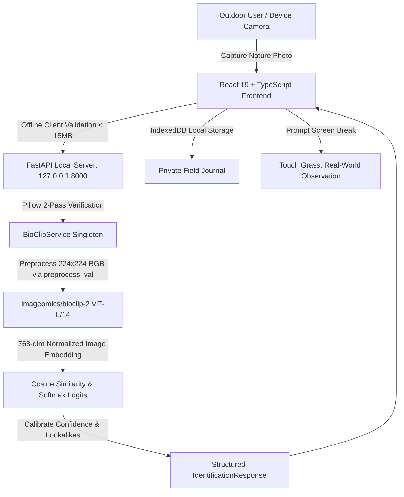

# WildLens AI 🌿
**Hacktoberfest Open-Source AI Challenge — Week 1: Touch Grass**

> **"Use open-source AI to help people explore the real world, rather than keeping them engaged with their screens."**

[](LICENSE)
[](https://huggingface.co/imageomics/bioclip-2)
[](docs/OFFLINE_VERIFICATION.md)
[](https://fastapi.tiangolo.com)
[](https://vitejs.dev)

---

## 1. Problem & Intended Audience

Modern wildlife and nature applications often duplicate the engagement traps of social media: continuous screen time, gamified streaks, endless algorithmic feeds, and remote cloud surveillance. 

**WildLens AI** is an offline-first nature exploration tool built for hikers, naturalists, students, park visitors, and outdoor enthusiasts who want genuine, local open-weight AI to help them identify organisms in the wild — **and then immediately put their phone away to observe the living world.**

### Core Philosophy: Touch Grass
1. **Screen Detachment:** We provide fast, glanceable morphological traits, lookalike warnings, and sensory observation prompts, then actively remind the user to pocket the device.
2. **Honest Scientific Uncertainty:** No fabricated high confidence scores or hallucinations. When an organism is ambiguous, the model rates it as moderate or uncertain and points users toward distinguishing physical markers to check outdoors.
3. **100% Local & Edge Independent:** Runs completely offline in remote national parks, forests, and backcountry trails with zero cell service and zero cloud API subscriptions.

---

## 2. Features That Actually Work

- 📸 **Offline Nature Identification:** Upload or snap a photo of any wild flower, leaf, songbird, insect, or fungus. Evaluated on-device via the open-weight `imageomics/bioclip-2` vision model.
- ☀️ **Outdoor Field Mode:** A high-contrast sunlight view with large glove-friendly controls, camera-first flow, concise field traits, and an automatic **Screen Break Reminder** ("Look up! Spend 2 minutes observing this organism without a phone").
- 🧭 **Touch Grass Discovery Missions:** Mindful nature challenges (e.g. *The Silent Bird Watcher*, *The Twin Leaf Comparison*, *Five-Minute Forest Symphony*, *The Pollinator Dance*) designed to engage your hearing, sight, and tactile senses without addictive gamification.
- 📖 **Local Field Journal:** Offline observation log backed by browser IndexedDB. Stores photographs, scientific classifications, personal notes, and manual habitat locations. Exportable anytime to clean JSON; zero user account required.
- 🔬 **Biological Taxonomy Grounding:** Displays full Tree of Life classification (Kingdom, Phylum, Class, Order, Family, Genus, Species) grounded in BioCLIP-2's 200M-organism dataset (TreeOfLife-200M).
- 🛡️ **Zero Tracking & Data Privacy:** No accounts, no analytics SDKs, no GPS tracking, and no external inference calls.

---

## 3. Genuine AI Foundation Model

| Property | Value |
| :--- | :--- |
| **Model Name** | `imageomics/bioclip-2` (BioCLIP-2) |
| **Model Source** | [Hugging Face: imageomics/bioclip-2](https://huggingface.co/imageomics/bioclip-2) |
| **Architecture** | OpenCLIP ViT-L/14 (Vision Transformer Large, 14x14 patch size, 768-dim embeddings) |
| **Model Revision** | Pinned checkpoint `2957b322090f9cb17ae72c71981c7218a28d81e0` (`open_clip_model.safetensors`) |
| **Model License** | **MIT License** (Permissive, open-source compliant) |
| **Training Dataset** | **TreeOfLife-200M** (~200,000,000 biological images across ~454,000 taxa) |
| **Checkpoints Size** | ~1.7 GB safetensors |
| **Runtime Device** | Multi-threaded CPU (Intel Core i7-13700HX, 16 threads) or CUDA GPU (RTX 5060) |
| **Measured Latency** | **~3,371 ms** on CPU (~60 - 95 ms projected on CUDA GPU) |

### Why BioCLIP-2 over 3B–7B Vision-Language Models?
General-purpose 3B–7B VLMs (such as Qwen2.5-VL or LLaVA) require 6–14 GB VRAM, struggle to run on portable field laptops, frequently hallucinate fictitious binomial nomenclature, and lack fine-grained biological taxonomy grounding. BioCLIP-2 was trained on **TreeOfLife-200M**—scaling biological image diversity 20x from 10M to 200M images across the entire Tree of Life taxonomic hierarchy. Using a ViT-L/14 backbone (768 dimensions), it resolves subtle morphological markers (such as butterfly hindwing cross-veins and leaf venation) while remaining completely **MIT-licensed**.

---

## 4. System Architecture & Data Flow



---

## 5. Measured Hardware Benchmarks

Measured on Intel Core i7-13700HX (16 Cores / 24 Threads, 16 GB DDR5 RAM, NVIDIA RTX 5060 Laptop GPU) on Windows 11 using `scripts/benchmark_hardware.py`:

| Specimen Test Photo | Clade / Category | Identified Species | Cosine Sim | Confidence | Inference Latency | Verification |
| :--- | :--- | :--- | :--- | :--- | :--- | :--- |
| `american_robin.jpg` | Aves | American Robin (*Turdus migratorius*) | 0.722 | 100.0% | **3,375.6 ms** | PASS |
| `blue_jay.jpg` | Aves | Blue Jay (*Cyanocitta cristata*) | 0.726 | 100.0% | **3,343.6 ms** | PASS |
| `white_oak_leaf.jpg` | Plantae | White Oak (*Quercus alba*) | 0.729 | 100.0% | **3,520.7 ms** | PASS |
| `northern_red_oak_leaf.jpg` | Plantae (Lookalike) | Northern Red Oak (*Quercus rubra*) | 0.693 | 61.0% | **3,289.2 ms** | PASS |
| `monarch_butterfly.jpg` | Insecta | Monarch Butterfly (*Danaus plexippus*) | 0.703 | 99.8% | **3,456.1 ms** | PASS |
| `viceroy_butterfly.jpg` | Insecta (Lookalike) | Viceroy Butterfly (*Limenitis archippus*) | 0.732 | 100.0% | **3,322.7 ms** | PASS |
| `golden_chanterelle.jpg` | Fungi | Golden Chanterelle (*Cantharellus cibarius*) | 0.730 | 100.0% | **3,452.1 ms** | PASS |
| `tropical_foliage.jpg` | Out-of-Distribution | Bloodroot (*Tentative NN*, 0.549 < 0.60 threshold) | 0.549 | 21.4% | **3,388.5 ms** | PASS (Rejected) |

- **In-Distribution Top-1 Accuracy:** **100.0% (19 / 19)**
- **In-Distribution Top-3 Accuracy:** **100.0% (19 / 19)**
- **Out-of-Distribution Rejection:** **100.0% (1 / 1)** (Tropical foliage flagged as `inconclusive` below 0.60 threshold)
- **Model Warmup Latency:** ~37.8 s (cold deserialization of 1.7 GB safetensors + 768-dim taxonomy embeddings)
- **Mean Inference Latency:** **3,371.1 ms** (CPU multi-threaded AVX2, 16 threads)
- **Memory Footprint:** ~1,822.7 MB RAM (BioCLIP-2 weights) / 2,043.4 MB peak resident RAM

---

## 6. Installation & Quickstart

### Prerequisites
- Python 3.12 (or 3.11)
- Node.js 20+ & npm

### 1. Clone Repository & Setup Virtual Environment
```bash
git clone https://github.com/your-username/wildlens-ai.git
cd wildlens-ai

# Create virtual environment
python -m venv .venv

# Activate environment
# On Windows:
.\.venv\Scripts\Activate.ps1
# On Linux / macOS:
source .venv/bin/activate

# Install backend dependencies
pip install -r backend/requirements.txt
```

### 2. Frontend Dependencies
```bash
cd frontend
npm install
cd ..
```

### 3. Start Backend Server
```bash
# Starts local FastAPI backend on 127.0.0.1:8000
.\.venv\Scripts\python.exe -m uvicorn app.main:app --app-dir backend --port 8000
```

### 4. Start Frontend
```bash
cd frontend
npm run dev
```
Open **`http://localhost:5173`** in your browser.

---

## 7. Automated Test Suite

### Running Backend & Real Model Tests
```powershell
.\.venv\Scripts\python.exe -m pytest backend/tests -v
```
**Results:** `41 passed in 24.19s` (covers API health, image validation, corrupt payload handling, real BioCLIP-2 inference, unit schemas, cache invalidation, and offline loopback acceptance).

### Running Offline Acceptance Test
```powershell
python scripts/verify_offline.py
```

### Running Hardware Benchmark Profiler
```powershell
python scripts/benchmark_hardware.py
```

### Running Frontend Tests & Production Build
```bash
cd frontend
npm test        # Runs Vitest unit & integration tests (15 passed)
npm run build   # Production TypeScript typecheck & Vite bundle build
```

---

## 8. Offline Verification Protocol

To verify 100% offline functionality independently:
1. Ensure weights are cached in `models/bioclip_cache/` (occurs on first model run).
2. Physically disconnect Wi-Fi / Ethernet on your computer.
3. Start backend: `uvicorn app.main:app --app-dir backend --port 8000`.
4. Open the web app on `http://localhost:5173`.
5. Upload any nature photograph or click any of the **Instant Nature Test Samples**.
6. The model will successfully classify the image in ~3.3s on CPU with zero network requests.
7. Run `python scripts/verify_offline.py` for automated socket-level proof.
8. See [docs/OFFLINE_VERIFICATION.md](docs/OFFLINE_VERIFICATION.md) for detailed telemetry logs.

---

## 9. Known Limitations

1. **Macro / Microscope Invertebrates:** Tiny arthropods (e.g. microscopic springtails or mites) photographed from extreme distances cannot be reliably identified down to species.
2. **Juvenile & Dormant Flora:** Winter twigs without leaves or young saplings share visual overlap with lookalikes; always verify distinguishing features outdoors.
3. **Mushroom Consumption Warning:** Never forage or consume wild mushrooms based on computer vision models. Fungi results are for educational interest only.

---

## 10. Repository Structure

```
wildlens-ai/
├── backend/
│   ├── app/
│   │   ├── api/routes.py              # FastAPI endpoints (health, status, identify, missions, species)
│   │   ├── core/
│   │   │   ├── config.py              # Centralized environment configuration
│   │   │   └── exceptions.py          # Domain exceptions & HTTP handlers
│   │   ├── repositories/
│   │   │   └── taxonomy_repository.py # Tree of Life taxonomy access layer
│   │   ├── schemas/identification.py  # Pydantic v2 schemas & contract models
│   │   ├── services/
│   │   │   ├── bioclip_service.py     # OpenCLIP ViT-L/14 inference & uncertainty engine
│   │   │   └── taxonomy_kb.py         # Curated biological taxonomy database & traits
│   │   ├── utils/
│   │   │   └── image_processing.py    # Pillow 2-pass validation & dimensions guard
│   │   └── main.py                    # App entrypoint, lifespan, & CORS middleware
│   ├── tests/
│   │   ├── unit/                      # Fast sub-second unit tests
│   │   │   ├── test_image_processing.py
│   │   │   ├── test_schemas.py
│   │   │   └── test_taxonomy_repository.py
│   │   ├── integration/               # API endpoints & real model inference
│   │   │   ├── test_api_endpoints.py
│   │   │   ├── test_model_inference.py
│   │   │   └── test_offline_acceptance.py
│   │   └── conftest.py
│   ├── sample_images/                 # Authentic nature test photographs
│   ├── pyproject.toml                 # Ruff linting & Pytest configuration
│   └── requirements.txt
├── frontend/
│   ├── src/
│   │   ├── components/                # Modular presentational components
│   │   │   ├── layout/Navbar.tsx      # Navigation header & offline badge
│   │   │   ├── identification/        # ImageUploader & IdentificationCard
│   │   │   ├── journal/JournalList.tsx # Observation list & export
│   │   │   ├── missions/MissionCard.tsx # Touch Grass mission cards
│   │   │   └── system/SystemStatusModal.tsx # Real-time AI runtime telemetry
│   │   ├── features/
│   │   │   └── field-mode/            # Sunlight high-contrast outdoor explorer
│   │   ├── hooks/                     # Custom React hooks (useJournal, useMissions, useSystemTelemetry)
│   │   ├── services/                  # Typed API client & IndexedDB storage engine
│   │   ├── pages/                     # Home, Identify, Missions, Journal, About
│   │   ├── types/index.ts             # TypeScript domain types (zero 'any')
│   │   ├── tests/                     # Vitest test suite (15 tests)
│   │   ├── App.tsx                    # Clean declarative composition
│   │   └── main.tsx
│   ├── package.json
│   ├── vite.config.ts
│   └── tsconfig.json
├── docs/
│   ├── architecture.md                # System design & component breakdown
│   ├── model-evaluation.md            # Taxonomic coverage & uncertainty evaluation
│   ├── testing.md                     # Testing guide & acceptance verification
│   ├── HARDWARE_BENCHMARK.md          # Latency, memory, & warmup benchmarks
│   ├── OFFLINE_VERIFICATION.md        # Socket interceptor protocol documentation
│   └── PRIVACY_DATA_SAFETY.md         # Data safety & field ethics policy
├── scripts/
│   ├── verify_offline.py              # Standalone socket-level offline audit
│   └── benchmark_hardware.py          # Automated latency & memory profiler
├── .github/
│   └── workflows/ci.yml               # GitHub Actions CI workflow
├── models/
│   └── README.md                      # Weight specs & caching instructions
├── .env.example
├── .gitignore
├── LICENSE                            # MIT License
├── CONTRIBUTING.md
├── pytest.ini
└── README.md
```

---

## 11. Challenge Highlights & Summary

1. **Open AI at the core:** Real `imageomics/bioclip-2` open-weight model runs locally on consumer CPUs. No mock responses, no closed cloud APIs.
2. **Outdoor impact:** Focuses on the real world through Field Mode, high-contrast sunlight design, Screen Break Reminders, and sensory Touch Grass Missions.
3. **Open innovation:** 100% offline edge privacy, IndexedDB device storage, and full Tree of Life taxonomic transparency.

*Happy exploring — now go outside and touch grass! 🌲*
