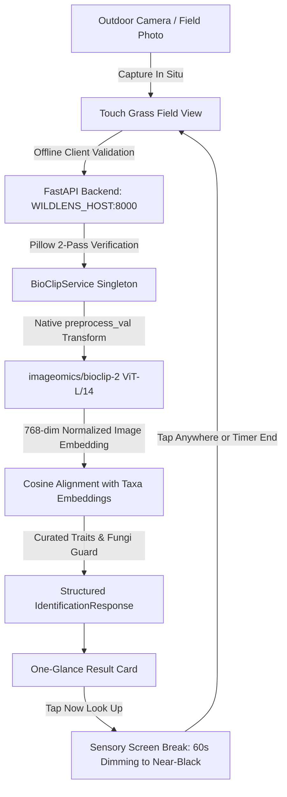

# Architecture & System Design

WildLens AI is an offline-first nature exploration and species identification platform designed to help people observe the natural world directly, with minimum screen distraction.

The core architectural requirement is complete local independence: all vision inference, image preprocessing, taxonomic resolution, and observation persistence execute on personal hardware without cloud APIs or network dependencies.

---

## 1. High-Level Architecture

```
[ Field Naturalist / Mobile or Laptop Browser ]
│
├── Frontend (Next.js 16 / React 19, TypeScript, Tailwind CSS)
│   ├── Touch Grass Field Mode Landing (Default View)
│   │   ├── Live Camera Viewfinder & Glove-Friendly Shutter
│   │   ├── One-Glance Result (Name, Confidence Band, 1-Line Trait, Fungi Guard)
│   │   └── "Now Look Up" Screen (Sensory Prompt + 60s Dimming Timer)
│   ├── Secondary Drawer Menu (Journal, Missions, Optical Loupe, Settings)
│   ├── Client Storage Engine (IndexedDB: 'WildLensAI_DB')
│   └── API Client Service (src/lib/api.ts)
│
└── Backend Service (FastAPI, Python 3.12, Uvicorn)
    ├── REST API Router (/api/identify, /api/missions, /api/model/status, /api/health)
    ├── Configurable Host Binding (WILDLENS_HOST=127.0.0.1 or 0.0.0.0)
    ├── Request Validation & Preprocessing (Pillow 2-pass verification, EXIF transpose)
    ├── Pydantic Schemas (strict contract serialization)
    ├── Curated Taxonomy Knowledge Base (taxonomy_kb.py: deterministic traits)
    └── BioCLIP-2 Inference Engine (Singleton ViT-L/14 runtime, 768-dim embeddings)
```

---

## 2. Component Separation & Responsibilities

### Frontend (`frontend/src/`)

- **`app/page.tsx`**: Default Touch Grass Field Mode landing screen:
  - Camera-first live viewfinder with large glove-friendly controls.
  - Glanceable result view: Common/scientific name, confidence band (`likely` / `possible` / `unsure`), one-line diagnostic trait, and unmissable mushroom safety alert.
  - "Now look up" mindful screen break: dims screen to near-black (`#050805`), displays sensory prompts, runs 60-second timer, returns to camera on tap or completion.
  - Slide-out drawer menu for secondary features.
- **`components/`**: Modular presentational components:
  - `Header.tsx`: Clean top navigation bar with telemetry modal toggle.
  - `CameraModal.tsx`: Accessible camera stream handler with permission diagnostics.
  - `system/SystemStatusModal.tsx`: Real-time hardware telemetry and BioCLIP-2 architecture inspector.
- **`app/journal/`**: Field observation history backed by browser IndexedDB with JSON export.
- **`app/missions/`**: Sensory nature exploration missions focusing on audio, visual, and tactile awareness.
- **`app/identify/`**: Detailed Optical Loupe dossier for in-depth taxonomic inspection.

### Backend (`backend/app/`)

- **`api/routes.py`**: Clean HTTP route handlers delegating to domain services.
- **`core/config.py`**: Centralized configuration (`WILDLENS_HOST`, `PORT`, `VISION_MODEL_ID`, `VISION_DEVICE`, `MODEL_CACHE_DIR`).
- **`services/bioclip_service.py`**: Thread-safe singleton managing the OpenCLIP BioCLIP-2 model, tokenizer, and precomputed 768-dim text embeddings with cache rejection on model change.
- **`services/taxonomy_kb.py`**: Curated, factual taxonomic knowledge base. Provides factual field traits, lookalike warnings, and fallback prompt (`"Not sure. Check leaf edges, bark, habitat, and markings."`).
- **`utils/image_processing.py`**: Two-pass image validation pipeline ensuring EXIF orientation normalization, RGB conversion, and dimension guards.

---

## 3. Data Flow: Field Identification Workflow



---

## 4. Outdoor LAN & Hotspot Phone Access

To run the backend on a laptop in a backpack while viewing from a phone outdoors without internet:
1. Set `WILDLENS_HOST=0.0.0.0` in `.env` (or pass `--host 0.0.0.0`).
2. Connect both laptop and phone to the same portable Wi-Fi hotspot (no internet uplink required).
3. On your phone, open `http://<laptop-lan-ip>:3000`.

> [!WARNING]
> Binding to `0.0.0.0` exposes the backend server to all devices on the local network. Only use this on a trusted private hotspot or closed LAN, never on untrusted public networks.

---

## 5. Design Decisions & Trade-Offs

| Decision | Alternative Considered | Rationale |
|---|---|---|
| **Single BioCLIP-2 Vision Model** | Chained Generative VLMs (Qwen/LLaVA) | BioCLIP-2 provides grounded Tree of Life taxonomy trained on TreeOfLife-200M (200M images, MIT license). Eliminating language models reduces VRAM overhead by ~5.5 GB and eliminates hallucinated binomial names. |
| **Curated Deterministic KB** | LLM-generated field notes | Field notes come strictly from `taxonomy_kb.py`. When uncurated, displays honest generic check prompts rather than fabricating traits. |
| **Touch Grass Dimming Screen** | Continuous screen engagement | Dims screen to near-black with a 60s timer to encourage presence in nature and conserve device battery outdoors. |
| **Browser IndexedDB Storage** | Remote Cloud Database | Gives users complete data ownership. Observations persist locally with zero cloud synchronization. |
